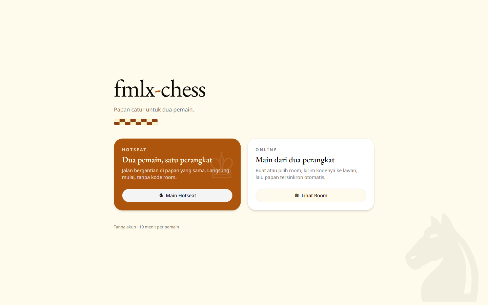
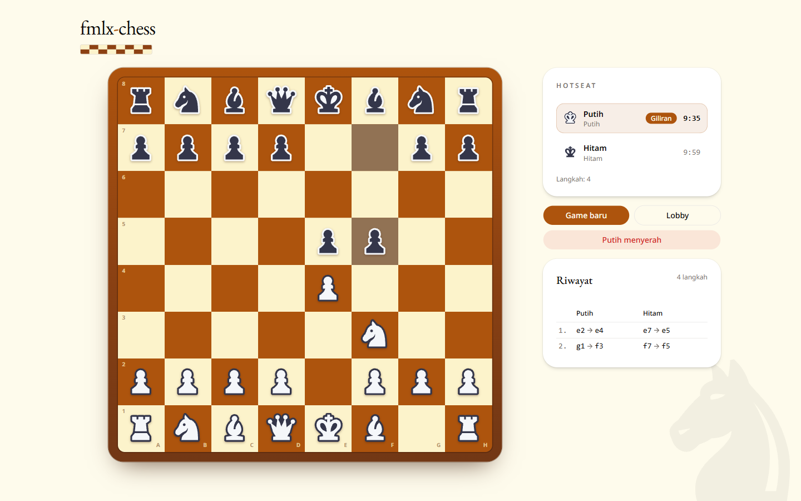

# fmlx-chess

Two-player chess: hotseat on one device, or online with a room code and realtime sync.

- **Live:** https://fmlx-chess.rizalanggoro.my.id/
- **API:** https://fmlx-chess-api.rizalanggoro.my.id/





## Features

- Hotseat (one device) and online (two devices, 6-character room code).
- Full chess rules: legal moves, check, checkmate, castling, en passant, promotion, stalemate, threefold repetition,
  fifty-move rule, dead position.
- 10-minute clock per player, ticking and timeout handled server-side.
- Draw offer/decline, resign, move history, captured pieces.
- Realtime board updates over SignalR (64-tile snapshot + state + history), no polling.
- Online lobby updates as rooms are created or seats are taken.
- `/scenario` — dev harness for running engine scenarios from the frontend.

## Stack

| Part     | Technology                                                                     |
|----------|--------------------------------------------------------------------------------|
| Backend  | .NET 8, ASP.NET Core MVC + SignalR, Swashbuckle (Swagger, dev only)            |
| Frontend | Vite, React 19, TypeScript, TanStack Router + Query, Tailwind v4 + shadcn, Bun |
| Realtime | SignalR (`/hubs/game`), groups `lobby` and `room:{id}`                         |
| Deploy   | Docker (2 images) → Docker Hub, GitHub Actions CI                              |

## Layout

```
backend/Chess.Api/
  GameEngine/               # rules & game state
  Controllers/ChessController.cs
  Services/RoomService.cs   # room registry + SignalR broadcasts
  Services/RoomRegistry.cs
  Hubs/GameHub.cs           # join/leave groups
  DTOs/ DTOs/Events/        # HTTP contracts & realtime payloads (also the FE codegen source)
  Swagger/                  # keeps event DTOs in the generated schema

frontend/src/
  routes/                   # `/`, `/rooms/`, `/rooms/$roomId`, `/scenario`
  components/chess-board.tsx
  hooks/                    # realtime listeners → query invalidation & toasts
  lib/api/                  # generated SDK + TanStack Query hooks (do not edit by hand)
  lib/game-hub.ts           # SignalR connection + group tracking
```

`class-diagram.md` / `class-diagram.mmd` are the assignment's reference diagram (read-only);
implementation deltas are recorded in `notes.md`.

## API

No `api/` prefix. Enums are serialized as strings.

| Method | Route                                                     | Description                                   |
|--------|-----------------------------------------------------------|-----------------------------------------------|
| POST   | `/rooms`                                                  | Create a room (`mode`: `HotSeat` \| `Online`) |
| GET    | `/rooms`                                                  | Online rooms with a free seat                 |
| POST   | `/rooms/{id}/join?name=&color=`                           | Claim a free seat                             |
| GET    | `/rooms/{id}`                                             | Room and seat status                          |
| GET    | `/rooms/{id}/game`                                        | Game state                                    |
| GET    | `/rooms/{id}/game/board`                                  | All 64 tiles                                  |
| GET    | `/rooms/{id}/game/legal-moves/all`                        | Every legal move                              |
| GET    | `/rooms/{id}/game/history?color=`                         | Move history                                  |
| POST   | `/rooms/{id}/game/start` \| `/reset`                      | Start / reset the game                        |
| POST   | `/rooms/{id}/game/moves?color=`                           | Send a move                                   |
| POST   | `/rooms/{id}/game/resign`                                 | Resign                                        |
| POST   | `/rooms/{id}/game/draw/offer` \| `/respond`               | Offer / answer a draw                         |
| POST   | `/rooms/{id}/game/draw/claim-threefold` \| `/claim-fifty` | Claim a draw                                  |

Errors are always `{ message, error }`: 400 invalid input/claim, 403 not a player or not your turn, 404 unknown room,
409 seat already taken, 500 otherwise.

### SignalR events (group `room:{id}`, plus `LobbyChanged` in `lobby`)

`SnapshotChanged`, `PieceCaptured`, `CheckDeclared`, `TimerTick`, `GameEnded`, `DrawOffered`, `DrawDeclined`,
`LobbyChanged`.

## Run locally

Backend (port 5004, Swagger at `/swagger`):

```bash
dotnet run --project backend/Chess.Api
```

Frontend:

```bash
cd frontend
bun install
bun run dev
```

After a backend contract change (backend must be running):

```bash
cd frontend
bun run openapi:export   # fetch /swagger/v1/swagger.json
bun run codegen          # regenerate src/lib/api
```

`VITE_API_URL` defaults to `http://localhost:5004`.

## Docker & CI

```bash
docker build -f backend/Dockerfile -t rizalanggoro/fmlx-chess:backend .
docker build -f frontend/Dockerfile --build-arg VITE_API_URL=https://fmlx-chess-api.rizalanggoro.my.id \
  -t rizalanggoro/fmlx-chess:frontend .
```

`.github/workflows/backend.yml` and `frontend.yml` build and push those images to Docker Hub on every `main` change.
Required secrets: `DOCKERHUB_USERNAME`, `DOCKERHUB_TOKEN`, `VITE_API_URL`.

## Limitations

- Rooms live in memory: a backend restart drops every room.
- No auth: anyone with the room code can claim a seat that is already taken.
